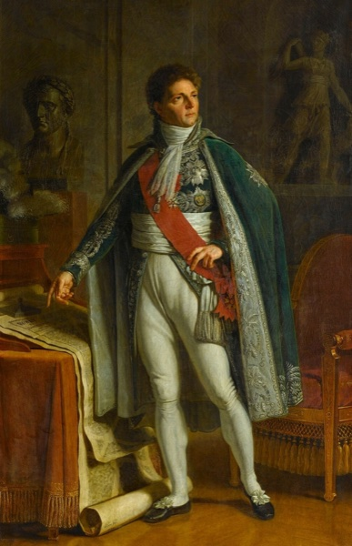

  

# berthier

Berthier runs the realtime control loop: it decides what to command each tick. `marengo-pi` drives it at 200 Hz.

Each tick reads joint state, computes gravity feedforward (`tau_g(q)` from [`armee-dynamics`](../armee-dynamics/)), applies the active mode and hands an MIT batch to [Davout](../davout/), which filters it and is the only path to the drives.

- Modes: GravityComp, Impedance, Position and TorqueOnly ([ADR 0004](../../docs/decisions/0004-control-modes-and-mit.md)).
- Position: trajectory, hold and per-joint law selection. Most joints use the [ADR 0007](../../docs/decisions/0007-bench-position-trajectory-control.md) law; joints set to `scaled_pd` in `config/control.yaml` use the [ADR 0039](../../docs/decisions/0039-position-control-simplification.md)/[0040](../../docs/decisions/0040-scaled-pd-slow-speed-law.md) law (today only `right_shoulder_pitch`, as a bench trial).
- Friction feedforward, ascent/hold/wave fuses, degraded hold after a drive loss ([ADR 0038](../../docs/decisions/0038-single-drive-loss-degraded-hold.md)).
- Publishes `RobotState` on [Chappe](../chappe/) at a lower rate than the motor loop.

It does not open CAN, enforce limits or parse URDF limits; those belong to Davout and robstride. There is no planner crate yet, so setpoints come from the operator (stdin or Consul through the gateway); see [ADR 0014](../../docs/decisions/0014-jetson-perception-semantic-motion.md) for the planned Jetson layer. Module map: [`src/codemap.md`](src/codemap.md).
