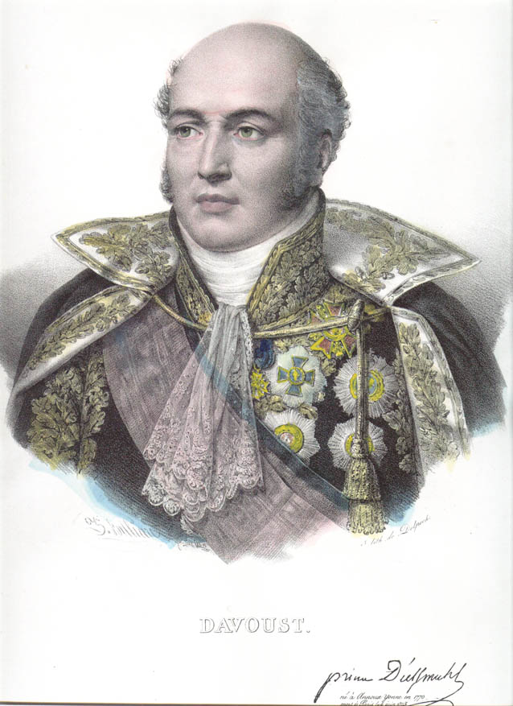

  

# davout

Davout is the safety layer.

It sits between [Berthier](../berthier/) and [`robstride`](../robstride/) and is the only crate allowed to send motion to the drives. Nothing reaches the motors without passing Davout.

- **Supervisor state machine:** Disabled → Ready → Active, with persistent faults that survive disable and replay.
- **Command filter:** URDF ∩ bench limits with the velocity-scaled envelope ([ADR 0009](../../docs/decisions/0009-dynamic-position-limit-envelope.md)), per-motor-type `kp`/`kd`/`tau_ff` caps, `tau_ff` rate limiting, the predicted total MIT torque bound, and danger zones from `config/control.yaml`.
- **Coordinates:** owns joint↔motor conversion (`direction`, `gear_ratio` from `config/motors.yaml`), so Berthier stays in joint space and robstride in motor space.
- **Reference and enable:** physical Set Zero with process-local per-joint grants ([ADR 0036](../../docs/decisions/0036-physical-robstride-reference.md)). A grant is revoked on MCU identity change, coordinate discontinuity, Calibration mode or silence beyond `comm_watchdog_ms`; a fault, E-stop or uncertain stop revokes all of them. Scoped Enable needs a grant for every target joint; Berthier's enable completion gate then waits for fresh feedback from each.
- **Drive loss:** a single dead drive sheds its subtree and the rest of the limb holds or lowers under control ([ADR 0038](../../docs/decisions/0038-single-drive-loss-degraded-hold.md)).
- **Watchdog:** stale feedback faults the supervisor.

Rules for changing anything here are in [`docs/safety.md`](../../docs/safety.md). Module map: [`src/codemap.md`](src/codemap.md).
