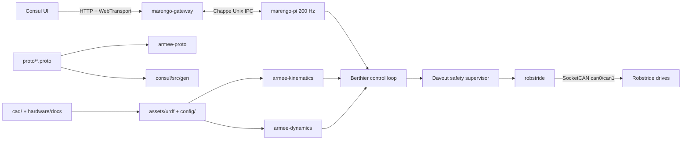

# Architecture

Current state, open defects and next steps are in [status.md](status.md). The working hardware is the right 5-DOF bench arm; the same stack is meant to run the full 23-DOF body with more joints. Planning, perception (Jetson) and locomotion are future work ([roadmap.md](roadmap.md)).

CAD, kinematics, and wiring describe the machine. The Rust workspace (Armée), message bus, control and safety consume that description. Detailed runtime contracts (stdin grammar, enable gate, reference grants, motion owner) are in [AGENTS.md](../AGENTS.md).

Wire types are defined once in [`proto/`](../proto/) as Protocol Buffers and generated into Rust ([`armee-proto`](../crates/armee-proto/)) and TypeScript ([`consul/src/gen/`](../consul/)). [ADR 0001](decisions/0001-protobuf-wire-types.md).

## Data flow (high level)

The gateway is the Chappe IPC listener (`/run/marengo/chappe.sock`); `marengo-pi` connects as a client when `MARENGO_CHAPPE_SOCKET` is set. Commands from Consul arrive on an allowlist of Chappe command topics and are refused when more than 1000 ms old. Motion is accepted only from the process's motion owner (`stdin` or `chappe`).

A future Jetson node sits above Chappe (vision, intent) and never talks to CAN or motors ([ADR 0014](decisions/0014-jetson-perception-semantic-motion.md)).

## Control stack boundaries

Motor path is fixed: Berthier → Davout → robstride. Each crate documents its boundary at the top of `src/lib.rs`.

| Crate | Owns | Must not |
|-------|------|----------|
| [`berthier`](../crates/berthier/) | Joint-space trajectory, τ_g + position law / impedance → MIT batch, ascent/hold/wave fuses; publishes `RobotState` | CAN, limits, Cartesian IK, behaviour scripts |
| [`davout`](../crates/davout/) | Reference/enable sequencing, limit envelope, caps (incl. total MIT torque), watchdog, drive-loss handling, joint↔motor transform | Trajectories, URDF dynamics |
| [`robstride`](../crates/robstride/) | MIT encode/decode, lifecycle/param frames, CAN I/O, bounded receive | Policy, safety |
| [`armee-dynamics`](../crates/armee-dynamics/) | `gravity_torques(q)`, calibration fits | CAN, commands |
| [`armee-kinematics`](../crates/armee-kinematics/) | URDF limits, joint lists, velocity-scaled envelope (ADR 0009) | Control loop |
| [`chappe`](../crates/chappe/) | Pub/sub topics and IPC | Control policy |
| [`marengo-config`](../crates/marengo-config/) | YAML types/loaders, velocity-cap resolution, atomic profile writes | Runtime enforcement |

Infrastructure crates (`marengo-store`, `marengo-candump`, `marengo-deploy`, `marengo-host-metrics`, `marengo-imu`, `marengo-support`, `sim-harness`) are listed in the root [README](../README.md#software).

**Spaces:** joint space everywhere except robstride; Davout owns `direction` / `gear_ratio`.

## Scaling to the full body

- One master description (`config/` + `assets/urdf/marengo.urdf`). Adding a limb adds joints to it; there is no second control loop or per-profile config fork. Limb narrowing at runtime uses `MARENGO_JOINT_SUBSET` or Consul commissioning scope.
- Readiness aggregates Joint → Limb → Robot Ready ([CONTEXT.md](../CONTEXT.md)).
- Known scaling limits today: CAN channel count and the MCP2515's 2-frame receive FIFO, gravity-only dynamics, and the Pi's single realtime loop. See the open decisions in [status.md](status.md#open-design-decisions).

## Dev tooling

[`dev-setup.md`](dev-setup.md): `protoc`, `buf`, and the regeneration workflow. [`windows-macos-development.md`](windows-macos-development.md): host checkouts and Docker.
