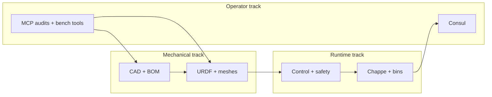

# Marengo roadmap

Target: a 23-DOF biped humanoid in the Unitree G1 class (~1524 mm, ~38–42 kg, no dexterous hands in v1). One repo for CAD, runtime, and operator tooling on the full machine. The targets are open to better ideas; change them through an ADR.

Furthest along today: the **right 5-DOF arm** on the bench and the upper-torso 2020 frame. The arm is not a separate robot. It is the first subsystem we can bench, audit and harden while the rest of the body is designed. Everything built for it (control, safety, config, tooling) must carry over to the full body with more joints, not a second code path.

Current state, bench results and open decisions: [status.md](status.md).

| Doc | Role |
|-----|------|
| [status.md](status.md) | Where things stand now: bench checkpoint, open issues, open decisions |
| [hardware/docs/kinematics.md](../hardware/docs/kinematics.md) | Joint names, limits, actuator map (humanoid SSOT) |
| [hardware/docs/torso-design-handoff.md](../hardware/docs/torso-design-handoff.md) | Torso CAD context and committed frame dims |
| [docs/architecture.md](architecture.md) | Software crate boundaries |
| [docs/safety.md](safety.md) | Bench and enable rules (read before motors) |
| [config/robot.yaml](../config/robot.yaml) | Master config: the live right 5-DOF arm |
| [config/robot_humanoid.yaml](../config/robot_humanoid.yaml) | 23-joint full-body template (tests only until M6) |

---

## Product definition (v1)

| Item | Target |
|------|--------|
| Form | Biped, no wheels |
| Height | 1524 mm standing |
| DOF | 23 actuated: legs 6 + 6, arms 5 + 5, waist 1. No hands; head skipped in v1 CAD |
| Actuators | Robstride RS04 hip pitch + knees; RS03 hip roll/yaw, waist, shoulders; RS02 ankles, upper-arm yaw, elbows; RS00 fifth arm joint |
| Proportions | G1 upper body, R1-class slim legs |
| Structure | 2020 aluminum torso cage (committed); pelvis/legs/shell draft; printed PETG/PLA brackets and panels |
| Power | 48 V main pack in the pelvis (draft); M18 aux bay (18 V, not the motor bus) |
| Compute | Pi 5 (control, CAN, IMU); Jetson Orin Nano (perception + intent, never motors; ADR 0014) |
| Bus | Chappe protobuf bus; SocketCAN 1 Mbit/s to the drives |
| Software path | Berthier → Davout → robstride (fixed; see [safety.md](safety.md)) |

---

## How to read this roadmap

Three **parallel tracks** advance the same humanoid. They do not finish in lockstep; only the **gates** at the bottom block unsafe or wasteful work.

**Execution slice (today):** the right 5-DOF arm (`right_shoulder_pitch`, `right_shoulder_roll`, `right_upper_arm_yaw`, `right_elbow_pitch`, `right_lower_arm_yaw`) on `can0`, with the master config and the CAD-derived URDF. It proves gravity compensation, Davout limits, reference/enable sequencing and CAN behaviour on real joints without waiting for legs or pelvis.

**Humanoid templates already in repo:** `robot_humanoid.yaml`, `motors_humanoid.yaml`, proto types and config validation tests. Use them for naming and CI alignment, not for bench enable until URDF/CAD for those joints exist. The template's CAN layout and left-arm joint names are open decisions ([status.md](status.md#open-design-decisions)).

Older 3-DOF and 4-DOF slices (left arm, dual shoulder pitch) are history; their URDFs are in `assets/urdf/archive/`.

---

## Milestones

Statuses: **done** · **active** · **next** · **later**

### M1 — Repository and architecture baseline

**Status:** done

- Workspace layout, ADRs, CI (`just check`), containerized dev
- Crate boundaries: Berthier / Davout / robstride / Chappe / proto
- Humanoid kinematics SSOT and humanoid config templates
- SolidWorks MCP audit tools (read-first; destructive CAD opt-in)

### M2 — Mechanical: torso and vendor truth

**Status:** active

**Goal:** committed upper torso cage, layout skeleton, RS03 bracket direction, vendor STEP in tree.

| Deliverable | State |
|-------------|-------|
| 2020 frame assembly frozen | Done: `marengo_torso_frame_asm`, [torso-2020-extrusion.md](../hardware/docs/torso-2020-extrusion.md) |
| Shoulder/waist RS03 brackets | Rev A designed: [torso-actuator-brackets.md](../hardware/docs/torso-actuator-brackets.md) (shoulder pitch inside the cage) |
| Layout part with named URDF refs | Open: `marengo_torso_layout` mostly empty ([cad/README.md](../cad/README.md)) |
| MCP design review clean | Open: `marengo_design_review`, `marengo_urdf_readiness` |
| Root assembly tree | `cad/assemblies/marengo.SLDASM` (local) |

**Parallel (draft, safe to iterate):** pelvis ring, shell, battery bays, hip splay, leg segments ([torso-design-handoff.md](../hardware/docs/torso-design-handoff.md)).

### M3 — Mechanical: limbs and full URDF export

**Status:** active for the right arm; next for everything else

**Goal:** `assets/urdf/marengo.urdf` and meshes cover the whole body; Brawner export + [export-urdf.sh](../scripts/export-urdf.sh) + MCP `marengo_urdf_export_postcheck`.

| Subsystem | DOF | State |
|-----------|-----|-------|
| Right arm | 5 | Built; URDF geometry and inertials from CAD (2026-10-03). Meshes not exported yet |
| Left arm | 5 | Next; mirror the right arm once the naming decision is made |
| Waist | 1 | RS03 in the committed waist bay; adapter plate designed |
| Legs (×2) | 12 | Next; RS04 hip pitch / knee first for sign tests under load |
| Head | — | v1 CAD skipped; stub links OK in URDF |

### M4 — Runtime: prove the control stack on hardware (arm slice)

**Status:** active

**Goal:** the same stack that will run the humanoid, exercised on the right arm first.

| Step | State |
|------|-------|
| SocketCAN in `marengo-pi` / `motor-repl` (`MemoryBus`, `SimulationBus`, `FirmwareBus` are test-only) | Done |
| Qualified physical reference and enable sequencing (ADR 0036) | Done in software; enable soak 20/20 once, cause-B RX overruns still open |
| Single-drive loss handling (ADR 0038), total-torque bound | Done in software |
| URDF masses from CAD | Done (right arm, 2026-10-03); printed-part masses still estimates |
| GravityComp on the arm (limb playbook §4) | Arm-down passed with notes; elevated/wave pose not green |
| Position speed ladder (§5) | 25 % passed; 50 % not scored; pitch running the ADR 0039/0040 law trial |
| Limb sign-off (§9) | Not reached |

**Do not** treat a non-SocketCAN motor runtime as shipped.

### M5 — Electrical and CAN topology

**Status:** next

**Goal:** documented harness, power, Pi/Jetson roles, the full-body bus plan, and bring-up order per subsystem.

- Decide the full-body CAN plan (channel count, interface hardware, ID scheme) and record it in a hardware ADR ([status.md](status.md#open-design-decisions)).
- Wire the E-stop sense input and reflect it in Davout + proto `SafetyState`; own the drive-side CAN timeout policy.
- PDB design (48 V pack, fusing, pre-charge, E-stop breaking motor power).
- Commission joints in **dependency order:** waist → one leg (pitch/knee) → ankles → second leg → arms.

### M6 — Full-body config switch

**Status:** later

**Goal:** the runtime uses the humanoid URDF and joint list end to end (still with bench caps).

1. Point the master `config/` at the full joint list (no per-profile config forks; limb narrowing stays `MARENGO_JOINT_SUBSET` / commissioning scope).
2. Same Berthier loop and Davout supervisor with more joints; no "humanoid code path" fork.
3. Sim: regenerate MJCF from the production URDF; extend `sim-harness` beyond the arm.

### M7 — Multi-process runtime and operator UI

**Status:** active (gateway slice landed)

| Piece | State |
|-------|-------|
| Chappe gateway: HTTP + WebTransport, Unix IPC ([ADR 0008](decisions/0008-chappe-webtransport-transport.md)), access policy ([ADR 0033](decisions/0033-gateway-runtime-access.md)) | Done |
| Consul: live state, enable, faults, Hardware page (URDF/YAML, Set Limits, Set Zero, Ready, commissioning scope) | In progress; Overview has a primitive-shape 3D URDF preview |
| Pi ↔ Jetson network transport | Not started; `chappe::transport` was removed (2026-10-03 crate audit). ADR 0014 proposes a TCP bridge |
| Jetson runtime, planner (Talleyrand), perception/intent (Fouché), `models/` | Crates removed in the crate audit; recreate from [ADR 0014](decisions/0014-jetson-perception-semantic-motion.md) when the Jetson role and model scope are defined |
| Live log-level control from Consul | Later: `tracing_subscriber::reload`, validated filters, operator/source logged, TTL rollback |

### M8 — Locomotion and whole-body behaviours

**Status:** later

- Whole-body dynamics model (beyond gravity-only ADR 0005) and floating base.
- Standing / balance (ankle RS02 tuning, CoM from real masses, IMU).
- Gait or stepping: model-based control and/or learned policies in simulation (ADR 0003 D2), deployed through the same Berthier → Davout path.
- Teleop (the `bins/teleop` scaffold was removed in the crate audit), explicitly **after** arm G-comp is signed off on hardware.

---

## What we are not building (v1)

- Dexterous hands (stub links only)
- Hourglass / non-athletic shell aesthetic as a design driver
- JSON on the Chappe wire ([ADR 0001](decisions/0001-protobuf-wire-types.md))
- Direct `robstride` calls from Berthier or bins
- MCP destructive CAD without explicit user `confirm`
- Control policies tuned against placeholder or archived URDFs

---

## Decision gates (before adding code)

Use these to avoid throwaway work:

1. **New joint in runtime?** Named in `kinematics.md`, present in the exported URDF, motor row in the master `motors.yaml`, Davout limits derivable.
2. **New crate feature?** Fits the [architecture.md](architecture.md) boundary; if it touches motors, read [safety.md](safety.md).
3. **New proto field?** Change `proto/` first; regenerate Rust + Consul; `buf breaking` on PR.
4. **New CAD automation?** Audit tools first; write tools only with confirm and a handoff doc update.
5. **Humanoid-only behaviour?** Prefer a data-driven joint list from config over a second control loop.

---

## CAD / repo hygiene (ongoing)

- One canonical assembly per rev; avoid committing `*-OLD` / `*-BROKEN-*` long term (use git history).
- Assembly path in manifests matches on-disk casing: `marengo.SLDASM`.
- Do not overwrite the five-joint master model with an older local export (ADR 0018).

---

## Related ADRs

The full list with statuses is in [decisions/README.md](decisions/README.md). Most relevant to the milestones: [0003](decisions/0003-simulation-testing.md) sim tiers, [0004](decisions/0004-control-modes-and-mit.md) MIT and modes, [0005](decisions/0005-dynamics-library.md) dynamics, [0014](decisions/0014-jetson-perception-semantic-motion.md) Jetson, [0036](decisions/0036-physical-robstride-reference.md) physical reference, [0039](decisions/0039-position-control-simplification.md)/[0040](decisions/0040-scaled-pd-slow-speed-law.md) position law.

When a milestone changes, update **Status** here and in [status.md](status.md).
