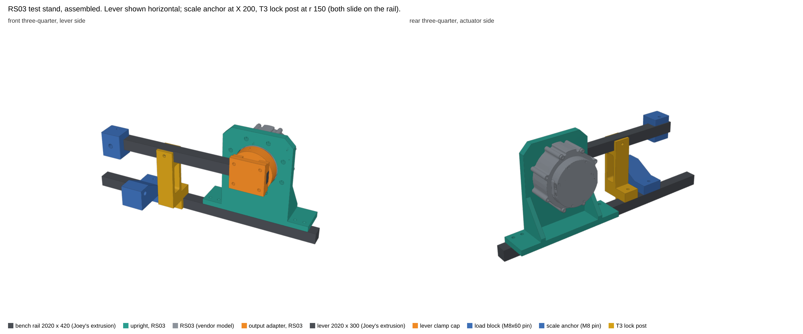
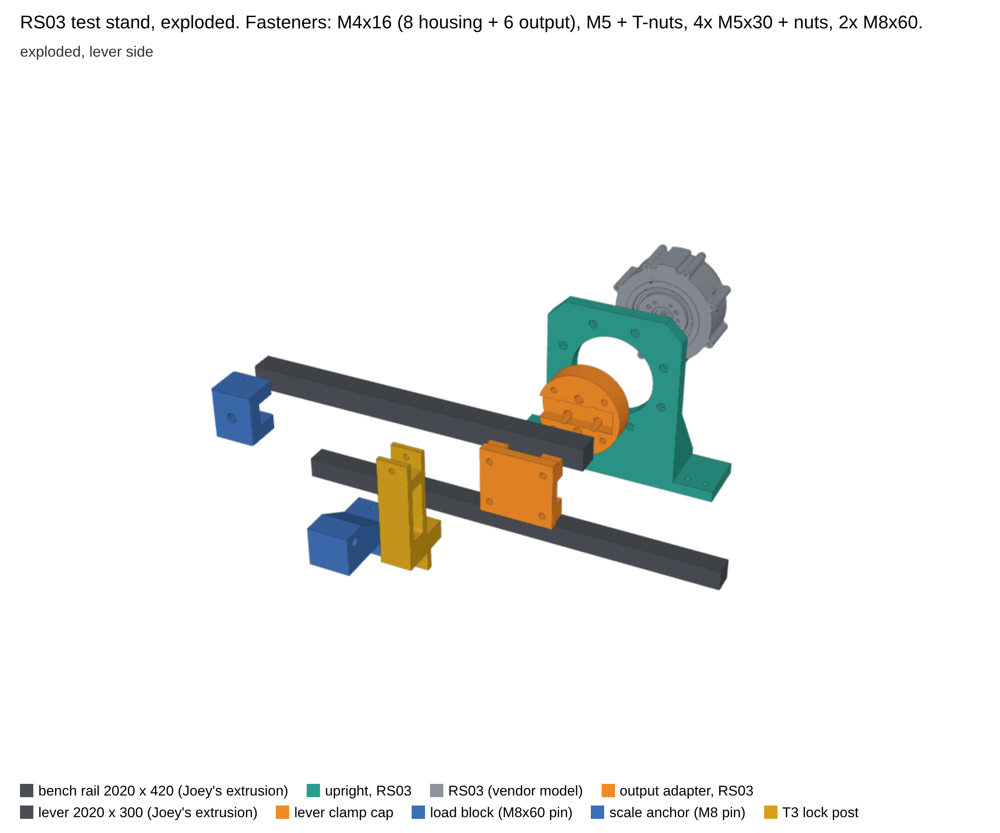
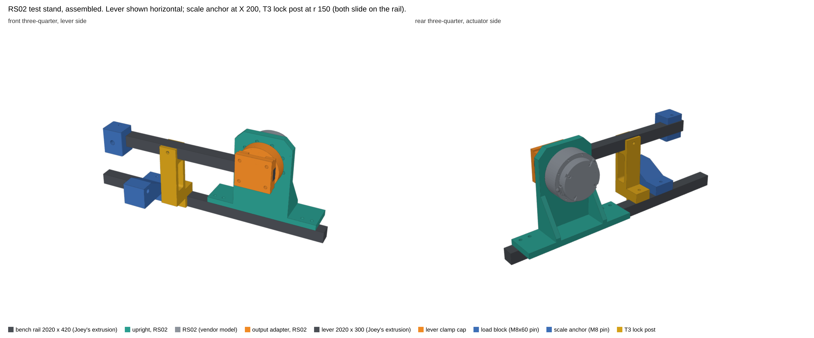
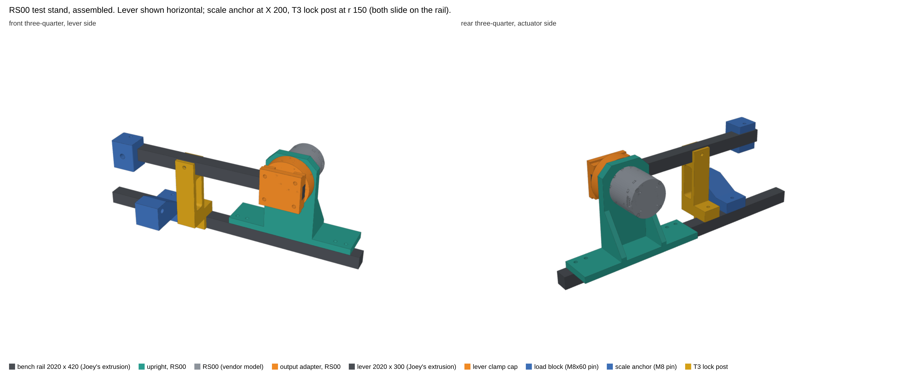
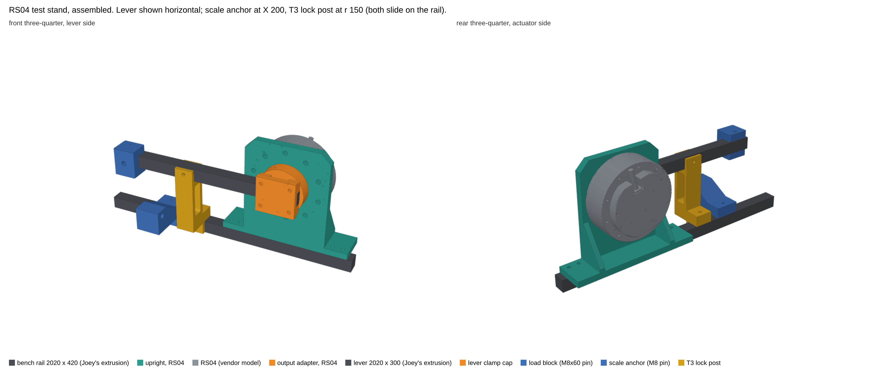

# Actuator test stand

**Status:** RS03 and RS02 sets sliced 2026-11-07 (plates in this folder). RS00 and RS04 uprights + adapters designed 2026-11-07, all four sizes now done. Spec: [sim-to-real-loop.md section 2](../../docs/sim-to-real-loop.md). Test order (Joey, 2026-11-07): **RS03 first (the uninstalled waist unit), then RS02, RS00, RS04.** Only the upright and the output adapter change per actuator size; the lever, clamp cap, load block, scale anchor and lock post are shared and already sized for the RS04 case.

## RS02 set (second in the test order)

Same stand, same lever, cap, load block, anchor and lock post. Only two new prints: `upright_rs02` and `adapter_rs02` (plates `teststand_rs02_upright`, `teststand_rs02_adapter`). Swap them for the RS03 ones; the axis stays 100 mm above the rail, so nothing else moves.

- Housing: **9× M3 on D73** into the housing front face (**vendor**: 9-M3, 8 deep), M3x14 (8 grip, 6 in the housing). Output flange D43 sits in a D48 bore; output face is 4.0 proud of the housing face (**vendor STEP**).
- Output: **6× M4x16 on D24** (**vendor**: 7 min deep; STEP 6), 10 grip, 6 engaged. The adapter spigot bears on the raised D29.7 output pad. On D24 the counterbores of four screws cross the channel walls, so they run into the channel as slots (no knife edges).
- Loads: RS02 rated 6 N·m stalled, 17 N·m peak, a third of the RS03 numbers above, so the RS03 load check covers it.
- Clear of the vendor RS02 model, lever and rail (**CAD check**); both parts pass the surface scan.

## RS00 set (third)

Two new prints again: `upright_rs00` and `adapter_rs00` (plates `teststand_rs00_upright`, `teststand_rs00_adapter`).

- Housing: **6× M3 on D50** (**vendor**: 6-M3; STEP 5 deep), M3x12, 8 grip, 4 in the housing. D39 bore clears the D35 output; output face 1.0 proud (**vendor STEP**).
- Output: **6× M3 on D27** (**vendor**: 5 deep blind), M3x14, 10 grip, 4 engaged. A D32 contact pad stays inside the D34.6 output face, then the spigot steps out to D37 so the counterbores stay inside it.
- Loads: the RS00 is the smallest unit, well inside the RS03 load check.
- Clear of the vendor RS00 model, lever and rail (**CAD check**); both parts pass the surface scan.

## RS04 set (last, the 40 N·m case)

`upright_rs04` and `adapter_rs04` (plates `teststand_rs04_upright`, `teststand_rs04_adapter`). Same 100 mm axis, so the lever, cap, load block, anchor and lock post carry over. The RS04 STEP has its output on +z (the others are on −z), so the script turns it a half turn first; connectors still point up.

- Housing: **10× M4 on D106** (**vendor STEP**: tapped 7 deep; drawing 5 min), M4x16, 9 grip, 7 in the housing. The plate is wider (±66) and the foot is ±102 with its T-nut holes at X ±76 and ±92, outside the plate.
- Output: **9× M5 on D36** (**vendor**: drawing 6.5 min deep), M5x16, 10.5 grip, 5.5 engaged. **Check the depth by hand first**: the STEP models the tapped holes only 3.5 deep. If an M5x16 bottoms out, use M5x14. Neighbouring counterbores 30° apart would leave slivers, so they merge into slots.
- Three **D6 dowel pins** on the output (2.7 proud) drop into D6.4 sockets 3.5 deep in the adapter face, so the adapter is located by the pins and bolts.
- Load at 40 N·m (**estimate**):
  - Clamp friction from the 9 M5s carries most of it. If it slips, the 9 shanks and 3 pins share 2.2 kN in bearing at about 4–5 MPa.
  - The channel walls see 2.8 MPa.
  - The upright's 10 housing screws see 75 N each, and the plate's in-plane bending at the foot is about 1.2 MPa.
  - The shared parts are already rated for the RS04 case in the load check below.
- Clear of the vendor RS04 model (pins sit in their sockets), lever and rail (**CAD check**); both parts pass the surface scan.

Evidence labels: **vendor** (RobStride STEP / manual), **CAD check** (this script), **estimate** (hand calc), **assumption**.

## Layout

- A 2020 **bench rail** (about 420 mm) clamped to the bench with two C-clamps. Everything else bolts to it with M5 T-nuts.
- The **upright** stands on the rail. The RS03 bolts to its back face by the housing's 8 front M4s on D98 (**vendor**: 8-M4, 8 deep). The output boss sits in a D74 bore and the output face is 9.5 mm behind the upright's front face. The actuator axis is horizontal, 100 mm above the rail top, and square to the rail. The connectors point up.
- The **output adapter** bolts to the output with 6× M4 on D30.36 (**vendor**: 6-M4, 6 deep). It only touches the D46 output disc. Its front has a channel the 2020 **lever** drops into. The lever end butts against a stop 30.0 mm behind the axis, and the **clamp cap** clamps the lever into the channel with 4× M5x30 into captive nuts.
- A **load block** clamps anywhere on the lever with 2 M5s into the lever's top and bottom slots. A captive M8x60 hex bolt sticks out forward on the lever centreline. The luggage scale's strap, or the weights, hang on it.
- The **scale anchor** slides along the rail until it sits under the load pin. The scale hook goes on an M8x70 bolt through its arm.
- The **T3 lock post** holds the lever horizontal at r = 150. A U-cradle grips the lever, with M5s into the lever's front and back slots.

Zero interference between every pair of parts, the vendor RS03 model, the lever and the rail (**CAD check**, `build_stand.py`).

### How T2 (torque truth) is set up

The scale can't fit under a horizontal lever: the axis is only 100 mm up, and a luggage scale with its strap is about 170–250 mm long. So **the lever is tilted up** until the scale hangs plumb between the load pin and the anchor. Typical tilt is 30–55°.

- The moment arm is the horizontal distance from the axis to the plumb line: **arm = r · cos θ**.
- r is measured once: arm r = (lever end to M8 pin centre) − 30.0.
- θ is the drive's own encoder angle, referenced to a level lever.

Slide the anchor until the strap hangs plumb. At 2° out of plumb the error is 0.06 %, so a phone level is enough. The lever only needs to be roughly perpendicular to the strap because θ is read, not assumed.

Example at r = 250 and θ = 40°: the arm is 191.5 mm. RS03 at its 13 N·m stall rating pulls 69 N (7.0 kg) on the scale. RS04 at 40 N·m pulls 209 N (21 kg). The 50 kg scale covers both.

### Lever sweep

With the lever fitted, it can swing through the upper half from about −20° (it reaches the bench) round to 200°. That covers the gravity sweep with weights. Set soft limits to −15° … 195° before any powered move with the lever on. For T1 (free spin), take the lever off and run the adapter alone.

## Parts

| Part | Print | Infill | Grams (est.) | Notes |
|---|---|---|---|---|
| `upright_rs03` | PETG, front face down | 4 walls, 25 % gyroid | ~160 | RS03 only; RS02, RS00 and RS04 get their own uprights at the same axis height |
| `adapter_rs03` | PETG, front (lever side) down | **6 walls, 100 %** | ~120 | Carries the torque. Channel floor prints as a 20 mm bridge |
| `clamp_cap` | PETG, front down | 4 walls, 25 % | ~45 | Shared |
| `load_block` | PETG, front down | 4 walls, 25 % | ~30 | Shared |
| `lock_post` | PETG, on its side | 4 walls, 25 % | ~55 | Shared |
| `anchor` | PETG, on its side | 4 walls, 25 % | ~65 | Shared |

None of these orientations needs supports: every overhang is a hole under 8.5 mm, a 1.5 mm counterbore step or the adapter's 20 mm bridge. All six parts pass `hardware/tools/mesh_check.py` (one watertight body, no sharp vertices, knife edges or thin walls). Plates: `teststand_rs03_upright`, `teststand_rs03_adapter`, and `teststand_fixtures` (cap, load block, lock post and anchor together). `build_prints.py` slices them on Joey-PC with the Bambu CLI, flags every changed setting and runs the surface gate first. Use the Cool Plate SuperTack with no glue and a 5 mm brim on the fixture plates.

## Buy / have

| Item | Qty | Why |
|---|---|---|
| Digital luggage scale, 50 kg / 10 g | 1 | The torque reference (already on the order list) |
| 2020 offcut ≥ 300 mm (lever) and about 420 mm (rail) | 1 each | Joey's own extrusion. Cut the lever end square: the 30.0 stop references it |
| C-clamps | 2 | Rail to bench, unless Joey already has a way to clamp it |
| M4x16 SHCS | 14 | RS03: 8 housing (9 mm grip, 7 into the 8 mm housing thread), 6 output (10 grip, 6 into the 6 mm output thread). RS02 reuses the 6 output screws |
| M3x14 SHCS | 9 | RS02 housing; 6 of them reused for the RS00 output |
| M3x12 SHCS | 6 | RS00 housing |
| M4x16 SHCS | 2 more | RS04 housing takes 10 (the 8 RS03 housing screws + 2) |
| M5x16 SHCS | 9 | RS04 output (M5x14 if the holes are only 3.5 deep) |
| M5 SHCS + drop-in T-nuts | 12 | Upright 4 (M5x14), load block 2 (M5x16), anchor 2 (M5x25 top, M5x10 front), lock post 4 (M5x25, 3× M5x10) |
| M5x30 SHCS + M5 hex nuts | 4 | Clamp cap |
| M8x60 hex bolt (load pin) and M8x70 bolt + nut + washer (anchor) | 1 each | Hex head captive in the load block |
| Weights for the gravity sweep | — | A water jug or a bag of steel hung on the load pin and weighed on the kitchen scale. No custom weights |

No bearings: the actuator's own output bearing carries the lever. Screws go in dry (testing phase, no threadlocker).

## Load check (hand calc, **estimate**)

The RS03 limits come from the October manual and the stall cap set 2026-11-07 (no spare actuators): stalled holds are capped at 13 N·m, and T2 runs to 13 N·m.

| Item | RS03 case | RS04 case (40 N·m) | Margin note |
|---|---|---|---|
| Strap force at the worst arm (125 mm, θ 60°) | 104 N | 320 N | Scale 490 N |
| Adapter channel wall bearing (walls ±30 mm) | 0.9 MPa | RS04 gets its own adapter | PETG ~45 MPa |
| Adapter to output, 6× M4 on R15.2 | 140 N shear per screw | — | Clamp friction carries it |
| Upright in-plane bending at the foot (120 × 12) | 0.5 MPa | RS04 gets its own upright | |
| Upright out-of-plane: strap force × 27.5 mm lever offset | 2.9 N·m into the ribs and 4 foot bolts | 8.8 N·m | |
| M8 load pin bending (12 mm out) | 47 MPa | 144 MPa | 8.8 grade yields at 640 MPa |
| Anchor arm root (40 × 18, 50 mm out) | 2.4 MPa | 7.4 MPa | |
| 2020 lever bending at the hub | 19 MPa | 58 MPa | 6063-T5 yields at ~145 MPa |

Nothing here is near a limit, so no FEA was run. The fixtures follow the "light as possible without being what breaks first" rule. If something does break in testing, we bolster that part.

## Tests (from sim-to-real-loop.md section 2.3)

| Test | Stand configuration |
|---|---|
| T1 free output | Adapter only, lever off |
| T2 torque truth | Lever on, load block at r ≈ 250, strap on the load pin, scale hook on the anchor, lever tilted until the strap is plumb |
| T2b gravity sweep | Lever on, known weight hung on the load pin, slow sweep inside the −15° … 195° soft limits |
| T3 backlash / stiffness | Lever horizontal in the lock post at r = 150. The measured stiffness includes the post, lever and adapter (estimated at a few % of the drive's), so it is a lower bound |
| T4 latency | Either configuration |
| T5 thermal | T2 setup, held stalled at the T2 cap, stopped at 60 °C |
| T6 excitation | Lever on with weight, inside the soft limits |

Weigh the lever + clamp cap + load block assembly and find its centre of mass (balance it on a pencil) before T2b and T6. Its own gravity torque is part of the data.

## Files

- `build_stand.py`: CadQuery build of every part in the stand frame, plus the interference check against the vendor RS03 STEP (RobStride Product_Information, CAN2.0, `RS03-20261030.stp`; not stored in the repo).
- `render_stand.py`: the two pictures (three.js in headless Chromium).
- `build_prints.py`: the Bambu CLI slice on Joey-PC, with the mesh gate.
- `out/`: STEP and STL per part. `ref_*` files are reference geometry only (lever, rail, vendor RS03): don't print them.

## Next

All four sizes are designed. Print each set when its turn in the test order comes up.
