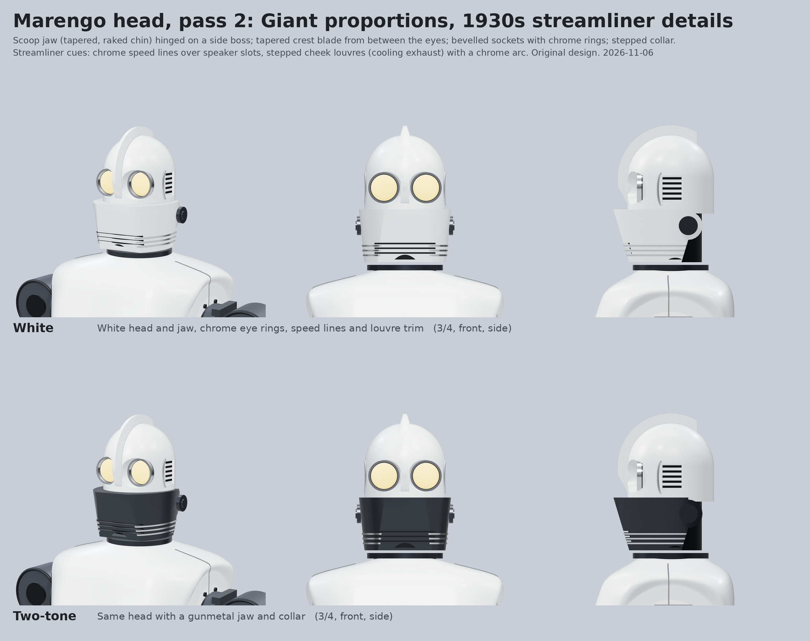
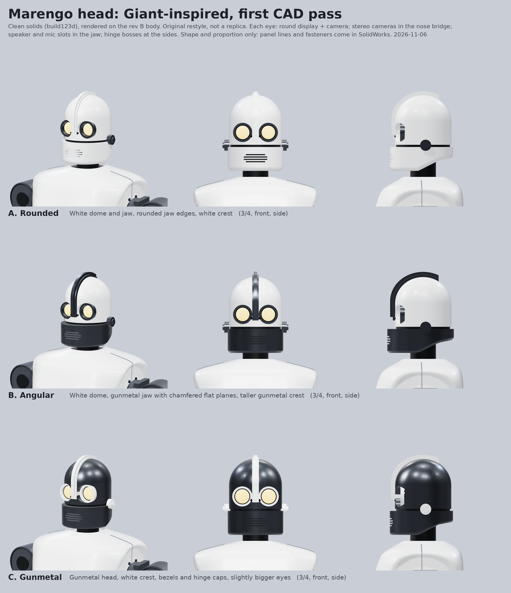

# Head: Giant-inspired concept

## Pass 2 (current, 2026-11-06)

From Joey's references (Giant side and front posters) and his style brief: *"his face should evoke images of 1930s
locomotives, elegant but brawny"* (reference: a 1930s streamlined steam locomotive nose). Model: `build_head2.py`.

- Scoop jaw over the lower face: tapers and rakes back toward the chin, pivots on a round side boss (servo jaw for speech).
- Tapered crest blade that starts as a point between the eyes and grows over the forehead.
- Big bevelled eye sockets with chrome rings (headlamp bezels); round display in each.
- Head sits straight on a stepped collar ring (neck yaw bearing inside), no visible neck column.
- Streamliner cues: chrome speed lines wrapping the chin over speaker slots; stepped cheek louvres with a chrome arc (cooling exhaust for the head electronics).
- Two colourways: white, and white with a gunmetal jaw and collar.

## Pass 1

2026-11-06. Joey picked a design that is sentimental to him (the Iron Giant, Brad Bird film) "with some slight alterations".
This is an **original restyle** in that spirit for marengo, not a replica: white armor and gunmetal to match the body,
a stepped keel crest, flat chamfered jaw planes (B), camera-hardware eye bezels, a speaker grille instead of a mouth.

| Variant | Look |
| --- | --- |
| A rounded | White dome and jaw, rounded jaw edges, white crest |
| B angular | White dome, gunmetal chamfered jaw, taller gunmetal crest |
| C gunmetal | Gunmetal head, white crest, bezels and hinge caps, slightly bigger eyes |

Size (all variants): about 128 wide, 140 deep, 190 tall (mm) from the jaw underside to the crown, plus the crest.

Function built into the shape (proposal, not yet checked against datasheets):

- Each eye: a round display (glow) behind a gunmetal bezel, so the eyes can blink, narrow and change colour.
- Stereo camera pair in the nose bridge either side of the crest base.
- Jaw: speaker and mic slots; it can hinge on the side bosses for speech.
- The head sits on a neck column in a collar ring; the neck yaw bearing goes there.

Files: `build_head.py` (build123d, writes STL per part + `parts.json` to `out/`, STEP for A). The STEP for A (`out/A_rounded/head.step`) is regenerated by the script; LFS uploads are blocked from the cloud session, so it is not committed yet.
Render: symlink `out/` as `giantout` in `hardware/designs/body-shell/concept/generator/`, then
`DPR=2 node shoot.js '[["gA_rounded","stl=A_rounded&hz=-12&ty=180&d=1350&az=32&el=8"], ...]'` and `python3 compose_giant.py`.
Concept only: the chosen variant gets rebuilt natively in SolidWorks on Joey-PC (cad/head/).

## Pass 3 (current): as close to the Giant references as possible

`build_head2.py A4` -> `HEAD_GIANT_PASS3.png`. One colour (white) with dark accents only; locomotive chrome dropped.
Domed bucket, crest blade starting as a point between the eyes, big round eyes (dark ring + glow), scoop jaw on side
hinge bosses with a raked chin, small ear blocks at eye height, head sitting low in a collar cup.
Known nits: dark gap behind the jaw hinge in side view; slight stepping on the crest.

`eye_states.py` -> `HEAD_EYE_STATES.png`: mock-up of how the round eye displays show what he is "thinking"
(idle, looking, focus, happy, sceptical, thinking, asleep, keep back). Animated on the real displays, combined with
head tilt/nod and the jaw.
