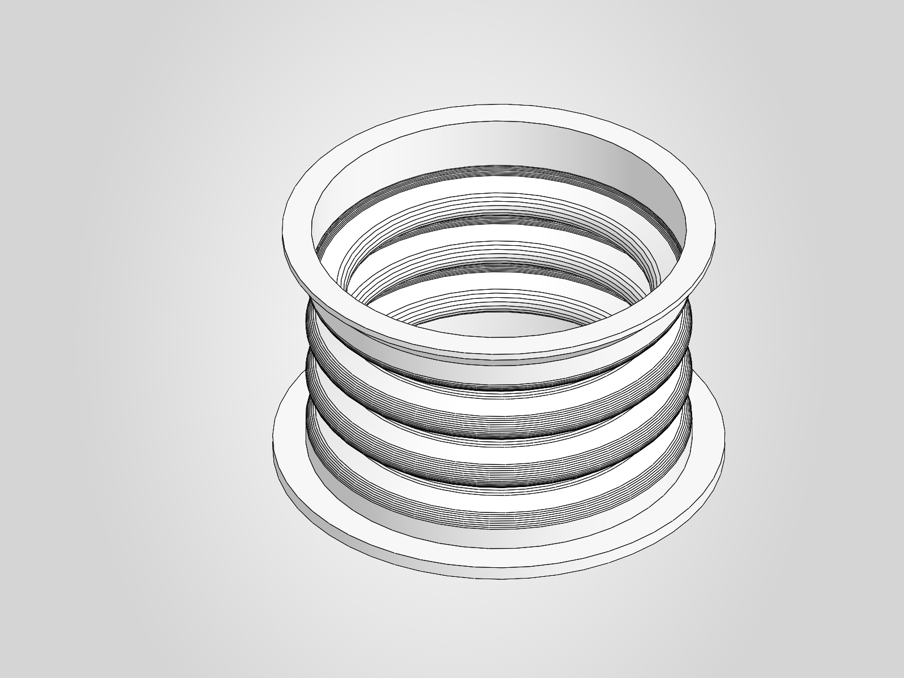
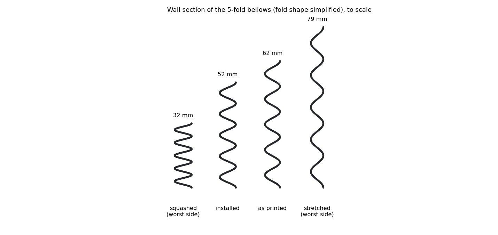

# Neck bellows: TPU test section (rev 0, 2026-11-07)

**Status: test section ready to print. The full bellows waits for your test result.**

Print file: [bellows/marengo_neck_bellows_test.3mf](bellows/marengo_neck_bellows_test.3mf) (also [STL](bellows/marengo_neck_bellows_test.stl), [STEP](bellows/marengo_neck_bellows_test.step)). Native part: `cad/neck/marengo_neck_bellows_test.SLDPRT`.

## Your first TPU print

The 3MF is Bambu Lab TPU 95A HF, black, using Bambu's own P2S profile: 0.12 mm layers, no supports, 2 h 23 min, 41 g.

**Plate: don't use the Super Tack for this.** Bambu's TPU 95A HF profile sets Super Tack to 0 °C, which means they don't support that pairing, and TPU can bond too hard to a sticky plate. I sliced for the Textured PEI plate at 35 °C. If you don't have one, tell me before printing.

1. **Dry the spool.** 65 °C for 12 hours in a filament dryer. TPU soaks up moisture fast, and wet TPU strings and bubbles. Do this even on a new spool if it has been open.
2. **Feed from the external spool holder, not the AMS.** Keep the path short, with no sharp bends, and make sure the spool turns freely. TPU is soft and buckles if it has to drag the spool.
3. **Load it.** Pick "External Spool" in Bambu Studio and set it to Bambu TPU 95A HF. Push the filament in by hand until the extruder grips it.
4. **Clean the plate** with dish soap and water. Skin oil causes more lifting than anything else.
5. **Print.** Open the 3MF, check the filament slot is External, and send it. Don't add a brim, support or infill.
6. **Watch the first layers** and the first fold. Stop if the filament is grinding, or if the flange lifts.
7. **Take it off when cold.** Flex the plate, then peel the flange slowly.

Settings in the file, from Bambu's profile unless noted: nozzle 230 °C, bed 35 °C, fan 100%, 60 mm/s outer wall, 0.8 mm retraction. My changes: 8 walls and 0% infill, so the walls fill the 1.2 mm section solid with no sparse infill, and no brim.

If it strings or the outer wall looks rough, lower the outer wall speed to 30 mm/s first.

## Test

It has the same fold shape as the real bellows, with 3 folds in place of 5. Measure the overall height, bottom of the flange to top of the rim.

| State | Overall height | Fold pitch |
|---|---|---|
| Squashed (worst corner) | **38.6 mm** | 6.35 mm |
| Installed, neutral | 50.7 mm | 10.4 mm |
| As printed | 57.0 mm | 12.5 mm |
| Stretched (worst corner) | **67.1 mm** | 15.9 mm |

Squash and stretch it between those two heights about 20 times, then check:

1. **Reach.** It gets to both heights without buckling sideways. A little ring-shaped bulge at the folds is fine.
2. **Damage.** No white marks, cracks or split layers at the fold roots.
3. **Force.** Press it on a kitchen scale to 38.6 mm and note the reading. **About 2.5 kg or less is good.** More than that, and the full bellows starts to take the servos' margin.
4. **Light.** Shine a phone torch inside in a dark room. Nothing should show through.
5. **Print quality.** Check the fold undersides. They are the steepest overhang on the part, about 69° from vertical, printed without supports.

Send me the force number and anything that looks wrong. I'd change the wall or the fold shape from that.

The 2.5 kg comes from the servo margin of about 0.4 N·m per servo after the head load, with half of that given to the bellows. It's a rough estimate, based on the bellows acting like a spring ring at r 37.

## Fold design

Five folds at 10.4 mm installed pitch, close to the 9 mm rings on the approved neck. OD r 41, 1.2 mm wall, opaque. Arc radius 2.5 mm on the wall centreline.

**It's printed longer than it's installed (62.5 mm vs 52 mm).** Printed at installed length, the flanks would be about 75° from vertical. Printing it longer eases the overhang, and leaves a little strain in place when installed.

**Single-wall or vase mode won't work.** A single line on a flank 69° from vertical gives a wall about 0.15 mm thick, nowhere near opaque.

| State | Length at crest | Bending strain at fold root |
|---|---|---|
| Squashed | 31.8 mm | 9.1% |
| Installed | 52 mm | 3.2% |
| As printed | 62.5 mm | 0 |
| Stretched | 79.3 mm | 5.8% |

Hoop strain stays under 2%. Numbers are in [bellows/bellows_numbers.json](bellows/bellows_numbers.json).

How strain was estimated: flanks stay straight and each fold's arc keeps its length, so the arc tightens or opens with the fold angle. Strain is half the wall times the change in curvature. A real flank also flexes, which would lower this, but the model is simple and hasn't been checked against a test or FEA. That's what the test is for. Script: [sw/bellows.py](sw/bellows.py).

## Changes the full bellows needs

These came out of the sizing. **None of them are built yet.**

1. **Head end moves up, from h 65 to h 72, onto a skirt hanging from the head plate.** At h 65 the head end swings too far relative to the rods, and they'd need a bore of r 35, which a r 41 bellows can't give. At h 72 they need r 30.3, against a worst-case bore of r 31.9. The folds also get longer, which is why the numbers above differ from the 33.9 to 74.8 mm in the first layout. This replaces the head-underside clamp you asked for with a clamp inside the head.
2. **Yaw tube stops at h 20.** The r 33 sleeve doesn't fit the new bore. The D plate moves into the journal at h 14 to 20, and the top flange grows into a r 39 spigot. The U-joint post gets 20 mm longer, and it needs a strength check.
3. **Jaw floor hole grows.** The folds reach r 41.5 and the hole is r 42. I'd go to at least r 43. Head thread to confirm.
4. **Rod gap is small.** Rods clear the worst-case fold root by 1.6 mm, with the bellows centreline modelled as a smooth S curve. Moving rod B's feet 1 to 2 mm outboard, still planned for this pass, uses some of that, so it gets rechecked then.

The interference re-run with the bellows, and the renders at 34° down and 20° roll, come with the full bellows.
