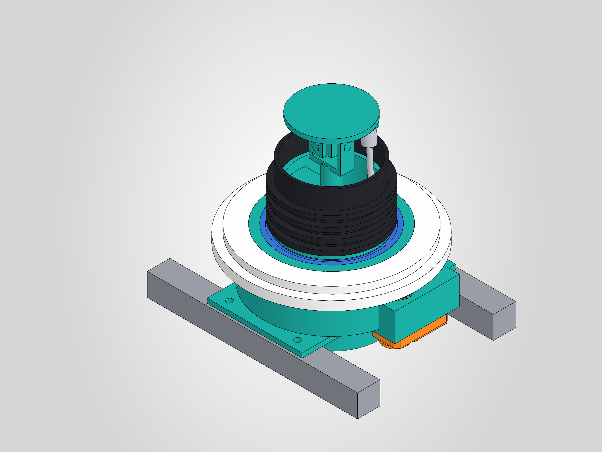
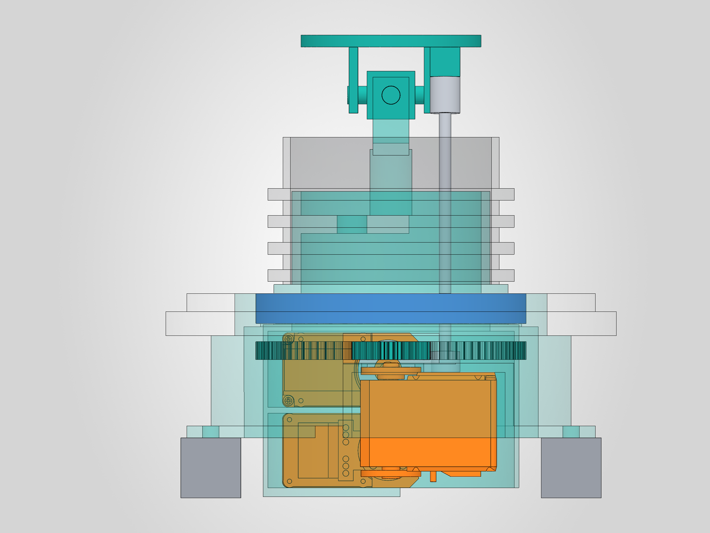
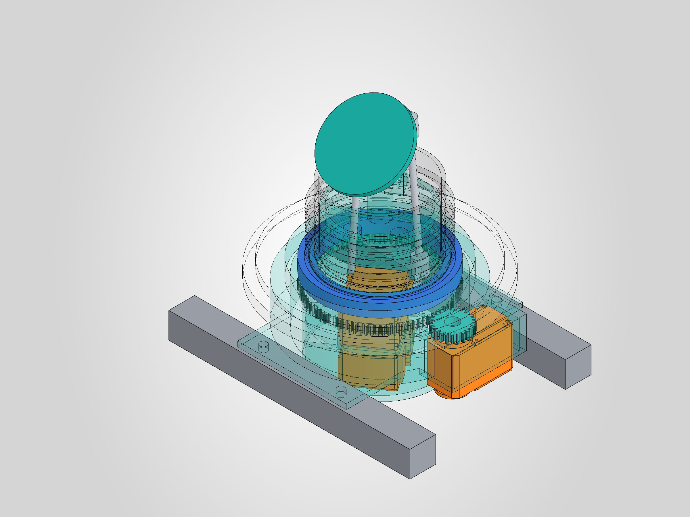
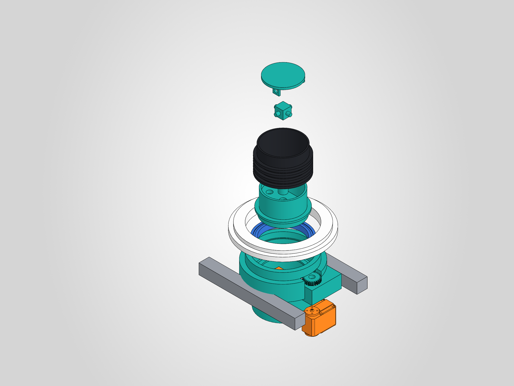

# Neck concept layout in SolidWorks (rev 0, 2026-11-07)

Option C at +10 mm: three Feetech STS3215 bus servos, U-joint 80 mm above the collar bottom. Range: pitch 34° down / 25° up, roll ±20°, yaw ±90°.

**Result: no clashes across the whole range, once three real clashes were fixed. One open problem: the bellows has to change length far more than a plain ribbed TPU tube can.**

| Render | |
|---|---|
|  |  |
|  |  |

More: [front](renders/NECK_SW_FRONT.png), [side](renders/NECK_SW_SIDE.png), [x-ray iso](renders/NECK_SW_XRAY_ISO.png). STEP: [sw/marengo_neck_layout.step](sw/marengo_neck_layout.step).

Native files are in `cad/neck/` on Joey-PC, top file `marengo_neck_layout.SLDASM`. Scripts are in [sw/](sw/): `run_all.py` rebuilds everything in one SolidWorks launch.

This is a concept layout. Parts are right in size and position, but they are not ready to print. Components are placed by transforms from [sw/neck_geom.py](sw/neck_geom.py), not mated.

## What was built

Torso frame: X lateral (+X robot left), Y up, Z forward. h is height above the collar bottom (Y 529).

| Part | Numbers | Make |
|---|---|---|
| 61814 bearing | 70 × 90 × 10, h 4 to 14 | Buy |
| Tower | Foot on both top rails, wall r 49 to 60, bearing seat r 45, 4 M5 T-nuts at X ±30, Z ±60 | Print |
| Yaw tube | r 35 through the bearing, r 33 above it to h 48, D plate at h 34 to 40 carrying the U-joint post, 2 × Ø10 cable holes | Print |
| Servo cage | Under the tube, wall r 41 to 42.6, open at the rear, carries the ring gear | Print |
| Ring gear and pinion | Module 1, 88 and 24 teeth, 3.67:1, h -8 to -2 | Print |
| Pitch/roll servos | Two STS3215 flat and stacked, Y 478.4 to 530, outputs on opposite sides | Buy |
| Yaw servo | Fixed at X 56, shaft up, Y 480 to 520, in a pod on the tower | Buy |
| Horns | Radius 19 | Print |
| Pushrods | Ø4 rod with ball links, centres 91.6 and 118.3 mm | Buy: rod and ball links, not sensible to print at this size |
| U-joint | Printed cross and yoke, Ø6 pins | Print, pins bought |
| Head plate | r 30 at h 96 to 100, ball studs at X(back) -18, ±15 lateral, level with the U-joint | Print |
| Bellows | r 36, ribs r 41, h 17 to 66 | Print, TPU |

Servo geometry is `STS3215_03a.step` from [TheRobotStudio/SO-ARM100](https://github.com/TheRobotStudio/SO-ARM100) (`STEP/SO100/`), not a Feetech file. It measures 45.4 × 24.8 × 34 mm, plus an output boss and spline to 39.6 mm, with the shaft 10.2 mm from one end. Check it against a real servo before fixing the cage.

## Checks

| Check | Result | Limit |
|---|---|---|
| Solid interference, 12 corners (pitch × roll × yaw ±90/0) plus neutral | **0 hits** | 0 |
| Solid interference, 8 mid-range poses, and neutral with the bellows in place | **0 hits** | 0 |
| Horn angle, worst over the range | **49.2°** | ≤ 65° |
| Rod outer radius in the sleeve (bore r 30) | 27.9 | 2.1 clear |
| Rod radius in the bearing bore (r 35) | Under 30 | Clear |
| Ball link radius at the head | 28.4 | Bellows bore 33.5 |
| Rod B to servo A body | 1.06 mm | Tight, see below |
| Rotating parts sweep, below Y 495 | r 45 (ring gear tip), ball links r 32 | r 48 |
| Lateral reach | X 72 (pod), yaw servo X 68.4 | \|X\| < 78 |
| Lowest fixed-frame stack point | Cage floor Y 475.4 | Y 475 target met |
| Lowest moving point | Rod B ball link, Y 472.6, at pitch-up with roll | Below the Y 475 target, between the rails |
| Gear mesh over yaw ±90 | 0 overlap, 0.1 mm backlash | |
| Ball link angle out of the stud plane (studs along the head's left-right axis) | 21.9° | Buy links rated above this |
| Bellows length at r 36 | **33.9 to 74.8 mm, 49 neutral** | **Problem, see below** |
| Tower foot to the H1 nuts (X ±60) | Foot ends at X ±42 | 18 mm before nut width |
| Tower foot to the H2 nuts (X ±85) | Foot ends at X ±42 | Clear |
| Chin vs collar at 34° down, no roll | Clears at the 3 mm margin (from the study) | |

Interference is solid-on-solid. The ball joints are expected to touch, so those pairs are excluded. Rows are in [sw/interference.json](sw/interference.json) and [sw/extra_checks.json](sw/extra_checks.json). Everything else comes from [sw/precheck.py](sw/precheck.py).

Servo torque is unchanged from the [study](LAYOUT.md): 0.56 N·m per servo at 1.3 kg, against 0.98 N·m rated.

## What the build changed from the study

1. **Yaw tube necked down.** The study ran the r 35 tube into a bellows with a r 33.5 bore. It is now r 33 above the bearing.
2. **The horns sit outside the servo.** The study put rods at ±15 at the horn, inside the servo body. The rod feet are at ±20.2 and the rods lean in to ±15 at the head (under 4°).
3. **The ball studs need a lug.** The head plate is at h 96 so it clears the yoke, and lugs carry the studs down to the U-joint plane.
4. **Cage shelf and floor cut back to 3 mm behind the axis.** Horn B and its ball link hit both at the range corners.
5. **Yaw servo top boss.** The real servo has a raised boss that hit the pod shelf. It now has a slot.
6. **Bellows yaws with the tube.** It is clamped to the tube flange at h 14 to 17, not to the fixed collar, otherwise ±90° yaw would twist it.
7. **Assembly order.** The cage goes in through the bottom of the tower before the tower goes on the rails, and bolts to the tube from below.

## Open problems

1. **Bellows stretch (needs a decision).** A point at r 36 on the head end moves about ±23 mm at the corners, so the bellows has to work from 69% to 153% of its neutral length. Ribs on a straight tube won't do that. It needs deep folds, or a different cover such as a loose fabric sleeve. Deep folds change the look of the ringed neck and may need more radial room. This is real uncertainty, so a TPU test print is justified.
2. **Rod B past servo A has only 1.06 mm.** It clears on paper. Real ball link and rod tolerances may not. Moving the rod feet 1 to 2 mm outboard fixes it and leaves room in the sleeve.
3. **Rod B's link dips below the rail bottom plane** (Y 472.6) at pitch-up with roll, at r ≤ 32. It stays between the rails and well above the Pi 5 (Y 397), but the bay plan must keep that space free.

## Not done yet

- Cables: the service loop, and routing past the cage, aren't modelled. The D plate has 2 × Ø10 holes.
- Servo fixings in the cage and pod, and the bearing retainer on top.
- Strength. Nothing here has been simulated, including the U-joint post on the D plate and the thin tower lip under the bearing (1.5 mm wide).
- Jaw corners against the collar at combined pitch and roll. That needs the head solid, and is a head-thread check.
- The STS3215 datasheet check: spline, backlash, and the shaft position against the SO-ARM100 model.
